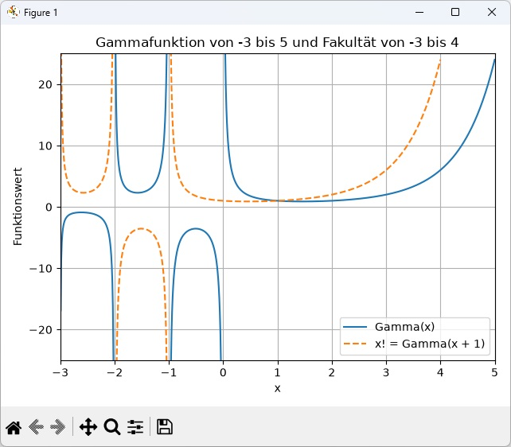

# Gammafunktion
Eulers Gammafunktion und die Fakultaet um deren Zusammenhang besser zu verstehen

## Verwendung

Die Fakultät kann mit einer Zahl als Kommandozeilenparameter berechnet werden:

```sh
python gammafunktion.py 5
```

Ohne Parameter fragt das Programm nach einer Zahl:

```sh
python gammafunktion.py
```

Mit dem Parameter `k` werden die Gammafunktion von -3 bis 5 und die
Fakultätskurve von -3 bis 4 in einem eigenen Fenster angezeigt.
Der sichtbare y-Bereich ist auf -25 bis 25 begrenzt:



```sh
python -m pip install -r requirements.txt
python gammafunktion.py k
```

Der Graph zeigt Gamma(x) als durchgezogene Kurve und x! = Gamma(x + 1)
als gestrichelte Kurve. Die Gammafunktion erweitert dabei die Fakultät
auch auf nicht ganzzahlige Werte. An den Polstellen werden die Kurven
unterbrochen: Gamma(x) ist bei 0, -1, -2, ... nicht definiert,
Gamma(x + 1) bei -1, -2, ... . Werte außerhalb des sichtbaren
y-Bereichs werden nicht angezeigt, aber nicht verändert.

Die numerische Eingabe akzeptiert weiterhin nur positive Zahlen.
